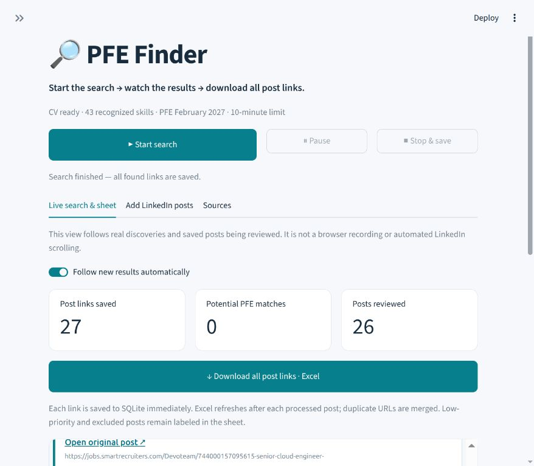

# PFE Opportunity Finder

**Centraliser les opportunités de stage PFE, les comparer à son CV et conserver les liens utiles dans Excel.**

Une application locale en Python et Streamlit pour suivre une recherche de stage en cybersécurité, DevSecOps, cloud et développement logiciel. Elle rassemble des offres issues de sources publiques configurées et des publications importées, explique leur score de correspondance et sauvegarde les résultats au fil de la recherche.



> Le profil de recherche actuel cible un PFE de six mois à partir de février 2027 au Maroc, notamment Casablanca, Rabat et Marrakech. Les critères de période et de localisation sont définis dans le code ; ils ne sont pas encore tous configurables depuis l'interface.

## Fonctionnalités

- **Recherche contrôlable** : démarrer, mettre en pause, reprendre et arrêter en conservant les résultats.
- **Résultats en direct** : affichage des découvertes et défilement automatique de la liste.
- **Analyse du CV PDF** : extraction du texte, des compétences et des domaines d'expérience.
- **Score explicable sur 100** : détail des correspondances, compétences manquantes et incertitudes.
- **Import de publications** : texte, liens, CSV, TXT, courriels EML et pages HTML sauvegardées.
- **Excel mis à jour progressivement** : liens d'origine, candidatures, scores, statut et provenance ; déduplication des URL.
- **Rapports par session** : exports HTML interactif, Excel et CSV, avec persistance SQLite.
- **Exécution bornée** : limite de temps, isolation des connecteurs et récupération après interruption.
- **IA facultative** : explication complémentaire via un fournisseur compatible, désactivée par défaut.

**LinkedIn fonctionne par import manuel.** L'application ne se connecte pas au compte LinkedIn et ne fait pas défiler son fil d'actualité. Le défilement visible dans le tableau de bord concerne les résultats collectés.

## Démarrage rapide

### Prérequis

- Linux / Ubuntu : plateforme de lancement et de gestion des processus actuellement prise en charge.
- Python **3.10 ou plus récent**, avec le module `venv`.
- Un CV PDF contenant du texte sélectionnable. Les PDF scannés nécessitent une étape OCR externe.

```bash
git clone https://github.com/houssam-ops/pfe-opportunity-finder.git
cd pfe-opportunity-finder
./start.sh
```

Le lanceur crée l'environnement virtuel, installe les dépendances manquantes et prépare la configuration locale. Une connexion Internet est nécessaire à la première installation.

Ouvrir **http://localhost:8501**, puis :

1. Déplier **Settings** et importer son CV avec **Replace CV → Use this CV**.
2. Vérifier les compétences extraites et les sources activées.
3. Cliquer sur **Start search**.
4. Utiliser **Pause**, **Resume** ou **Stop & save** pendant la recherche.
5. Télécharger **Download all post links · Excel** ou consulter les rapports détaillés.

Pour ajouter des publications LinkedIn, copier leur texte et leur lien dans **Add LinkedIn posts**, puis cliquer sur **Save posts**. Séparer plusieurs publications par une ligne `---`. Relancer une recherche pour les analyser. Un lien sans texte reste marqué comme nécessitant du contenu.

Aucun CV personnel, identifiant ou résultat de recherche n'est fourni dans ce dépôt.

## Sources et limites

Les sources activées par défaut sont **Devoteam Maroc via SmartRecruiters**, **Remotive** et un répertoire de pistes d'entreprises au Maroc. Les connecteurs Lever, RSS et pages `JobPosting` JSON-LD peuvent aussi être configurés dans `sources.json`.

Les pistes d'entreprises sont distinguées des offres : elles ne prouvent pas l'existence d'un stage ouvert. Les flux RSS et pages personnalisées nécessitent une autorisation documentée dans la configuration. Les sources externes peuvent évoluer, échouer ou ne retourner aucune offre adaptée.

La recherche porte sur les sources configurées, avec un cache de six heures pour les requêtes publiques. Elle ne couvre pas tout le Web. Les résultats sauvegardés sont réanalysés lors des sessions suivantes ; leur disponibilité doit être vérifiée sur le site d'origine.

## Comment fonctionne le score ?

Le CV PDF est la référence pour les compétences et l'expérience. Les six composantes sont :

- Compétences techniques : **35 points**.
- Durée et date de début : **20 points**.
- Localisation et éligibilité géographique : **15 points**.
- Expérience professionnelle : **15 points**.
- Domaines d'intérêt : **10 points**.
- Récence de publication : **5 points**.

Les niveaux sont **excellent** (90–100), **très pertinent** (75–89), **potentiel** (60–74) et **priorité faible** (< 60). Les postes seniors ou sans stage explicite sont plafonnés à 59. Les informations inconnues n'obtiennent pas tous les points ; les conflits et plafonds sont expliqués.

Il s'agit d'un classement heuristique pour aider à examiner les offres, pas d'une garantie d'éligibilité. Zéro correspondance est un résultat possible. Les règles détaillées sont décrites dans le [guide d'utilisation](docs/usage.md#cv-and-scoring).

## Données et exports

```text
data/
  cv/                         CV local, exclu de Git
  cache/                      Cache des sources publiques
  opportunities.sqlite3       Imports, sessions et résultats
output/
  post_links.xlsx             Dernière feuille de liens
  opportunities.html          Dernier rapport interactif
  opportunities.xlsx          Dernier rapport Excel complet
  opportunities.csv           Dernier export CSV
  sessions/<session-id>/      Fichiers propres à chaque session
```

Chaque résultat traité est enregistré dans SQLite avant l'actualisation de la feuille de liens. **Stop & save** exporte les données déjà enregistrées. La limite de temps continue pendant une pause ; la génération finale des fichiers intervient après la phase de collecte.

Les textes importés sont échappés dans le HTML et protégés contre l'interprétation comme formules dans les feuilles de calcul. L'application écoute uniquement sur l'interface locale par défaut.

## Configuration

Le fichier `.env` est créé à partir de [`.env.example`](.env.example) au premier lancement. Il est exclu de Git.

```dotenv
SESSION_DURATION_MINUTES=10
SOURCE_TIMEOUT_SECONDS=35
REQUEST_TIMEOUT_SECONDS=12
MAX_ITEMS_PER_SOURCE=150
AI_ENABLED=false
PORT=8501
```

Le chemin du CV peut être défini avec `CV_PATH`. Les sources sont configurables dans [sources.json](sources.json) ou dans l'onglet **Sources**.

L'analyse locale ne nécessite aucune clé API. L'option IA nécessite une configuration explicite et le consentement dans l'interface : elle transmet alors le texte du CV et des offres au fournisseur choisi et peut entraîner des frais. Elle ne modifie pas le score déterministe. Voir le [guide de configuration IA](docs/usage.md#optional-ai).

## Commandes utiles

```bash
# Analyser les imports et les sources configurées
.venv/bin/python runner.py

# Analyser uniquement les imports locaux
.venv/bin/python runner.py --offline --minutes 2

# Récupérer les résultats après l'arrêt du processus de collecte
.venv/bin/python recover.py

# Installer les dépendances de test et lancer la suite
.venv/bin/python -m pip install -r requirements-dev.txt
.venv/bin/python -m pytest -q
```

Les tests couvrent l'extraction du CV, les imports, le score, la déduplication, les exports, les pauses, l'annulation, les délais et les cas d'erreur. Les données synthétiques restent dans des dossiers temporaires. Le test du CV personnel est ignoré lorsqu'il n'est pas présent.

## Organisation du code

```text
app.py           Interface Streamlit et contrôles
live_view.py     Liste des découvertes en direct
collector.py     Imports et connecteurs de sources
cv_parser.py     Extraction du CV PDF
matcher.py       Score et explication facultative par IA
database.py      Persistance SQLite et déduplication
runner.py        Sessions, sous-processus et délais
exporter.py      Rapports HTML, Excel et CSV
recover.py       Récupération des résultats sauvegardés
config.py        Paramètres et validation
models.py        Modèles de données et normalisation des URL
tests/           Tests automatisés
```

Pour les détails sur les connecteurs, la récupération et les limites, consulter le [guide complet](docs/usage.md).

## Auteur

**Houssam Zouheir** — [@houssam-ops](https://github.com/houssam-ops) · [Portfolio cybersécurité](https://github.com/houssam-ops/portfolio-cybersecurite)
